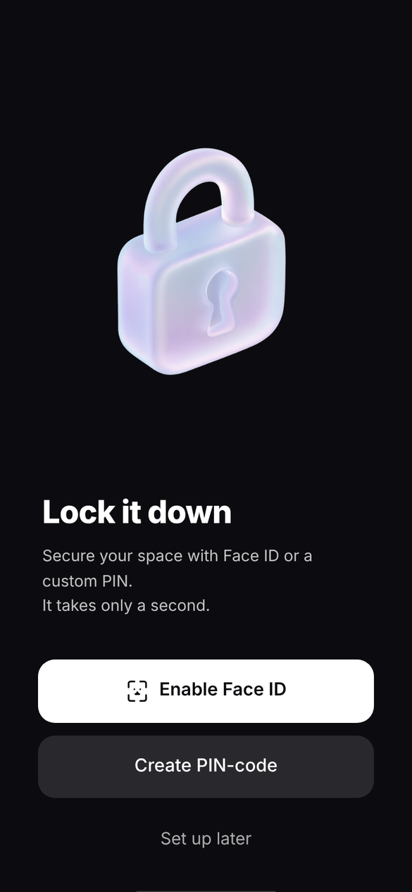
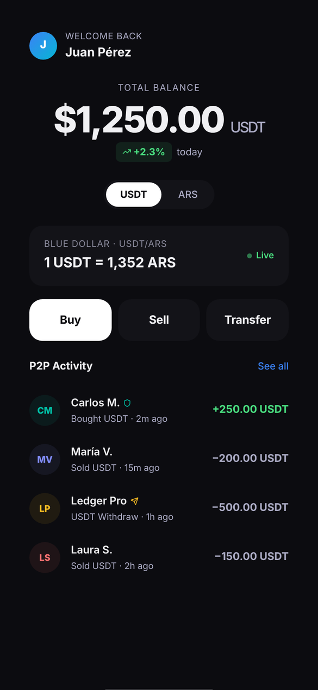
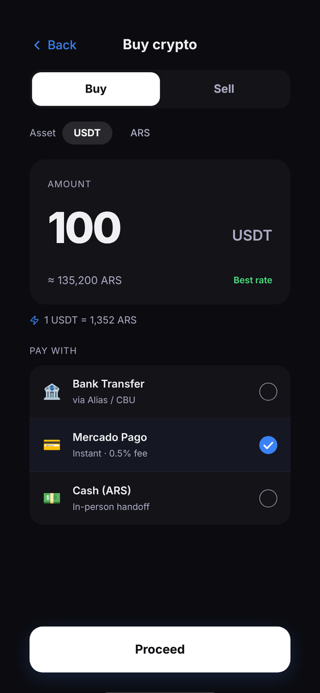
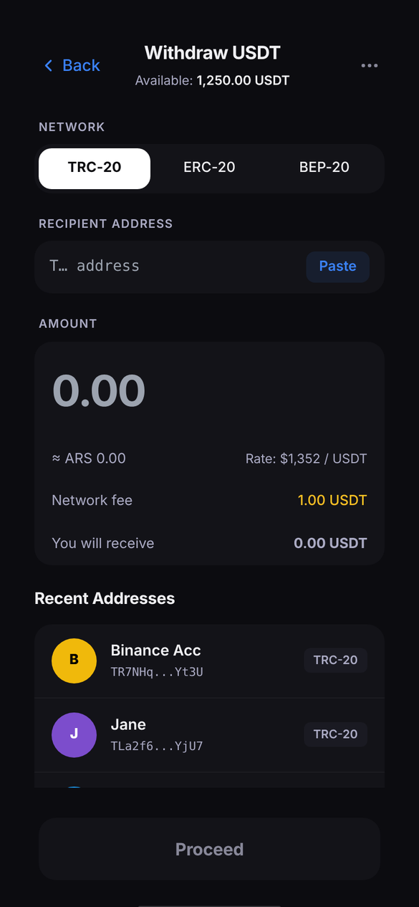

# P2P LATAM — USDT/ARS exchange

A mobile-first **P2P crypto exchange prototype for the Argentine market**, designed as a **Telegram Mini App**. Users buy and sell USDT for Argentine pesos at the blue-dollar rate, withdraw to external wallets, and receive funds via QR code.

**[▶ Live demo](https://dramanava.github.io/p2p_latam/)** — best viewed on a phone or in a narrow browser window.

> This is a UI/UX prototype. All data (balance, rate, transactions, addresses) is mocked; there is no backend or real blockchain connection.

## Screens

<table>
  <tr>
    <td align="center"><br><sub>Onboarding</sub></td>
    <td align="center"><br><sub>Security setup</sub></td>
    <td align="center"><br><sub>Dashboard</sub></td>
    <td align="center"><br><sub>Buy / Sell</sub></td>
    <td align="center"><br><sub>Review order</sub></td>
  </tr>
  <tr>
    <td align="center"><br><sub>Order placed</sub></td>
    <td align="center"><br><sub>Withdraw</sub></td>
    <td align="center"><br><sub>Receive (QR)</sub></td>
    <td align="center"><br><sub>Escrow onboarding</sub></td>
    <td></td>
  </tr>
</table>

## What it covers

- **Onboarding** — three story-style slides (privacy, live rate, escrow protection) and a Face ID / PIN setup step.
- **Dashboard** — balance in USDT/ARS, live USDT/ARS rate, recent P2P activity.
- **Buy / Sell flow** — amount input with live ARS equivalent, payment method selection (bank transfer, Mercado Pago, cash), order review and confirmation.
- **Withdraw** — network selector (TRC-20 / ERC-20 / BEP-20), address validation, recent addresses, fee breakdown, discard confirmation.
- **Receive** — network selector, QR code, copy-address action.
- **Telegram-ready layout** — fixed 100dvh viewport, safe-area spacing, bottom sheets that close on outside tap.

## Design decisions

- Dark, minimalist UI with no borders — separation through surface color and spacing.
- One clear primary action per screen (white button), blue reserved for selection and active state.
- 3D illustrations for onboarding and key states (success, security, warning).

## Tech

React 18 · Vite · Tailwind CSS · lucide-react. Inline styles with a single color palette object; no UI kit.

## Run locally

```bash
npm install
npm run dev
```

The UI lives in `src/components/CryptoApp.jsx`, rendered by `src/pages/Index.tsx`.
