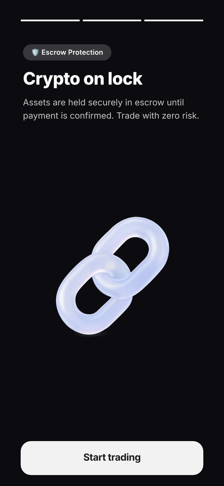
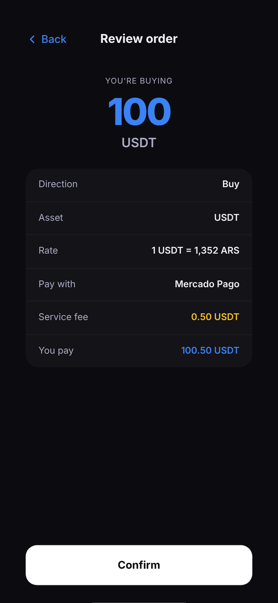
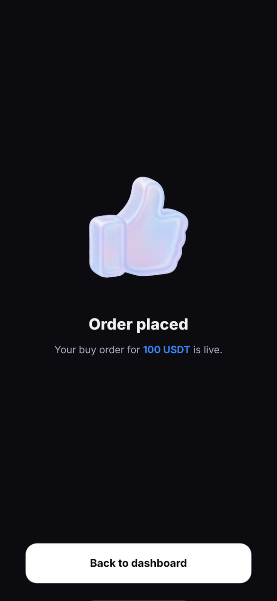
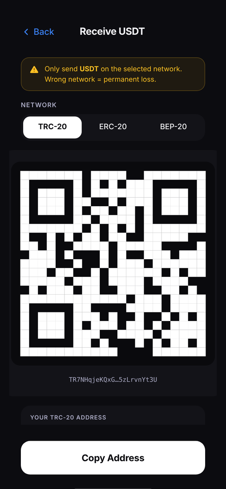

<h1 align="center">P2P LATAM</h1>
<p align="center"><b>USDT / ARS exchange — Telegram Mini App prototype</b><br>
Product and UI design · React</p>

<p align="center">
  <a href="https://dramanava.github.io/p2p_latam/"><b>▶ Open the live demo</b></a>
  <br><sub>Best on a phone, or in a narrow browser window</sub>
</p>

<p align="center"></p>

## About

In Argentina many people swap dollars for pesos at the informal "blue dollar" rate, and P2P trading of USDT has become one of the most common ways to do it. P2P LATAM is a design exploration of that experience as a **Telegram Mini App**: a simple, trustworthy flow for buying, selling and moving USDT without leaving the chat.

This is a **UI/UX prototype**. All data (balance, rate, transactions, addresses) is mocked; there is no backend or blockchain connection.

## The flow

**Onboarding** — three short stories and a Face ID / PIN step.

<table>
  <tr>
    <td align="center"><br><sub>Private by design</sub></td>
    <td align="center"><br><sub>Escrow protection</sub></td>
    <td align="center"><br><sub>Lock it down</sub></td>
  </tr>
</table>

**Trade** — pick Buy or Sell, enter an amount, choose how to pay, review, confirm.

<table>
  <tr>
    <td align="center"><br><sub>Dashboard</sub></td>
    <td align="center"><br><sub>Buy / Sell</sub></td>
    <td align="center"><br><sub>Review order</sub></td>
    <td align="center"><br><sub>Order placed</sub></td>
  </tr>
</table>

**Transfer** — withdraw to an external wallet, or receive with a QR code.

<table>
  <tr>
    <td align="center"><br><sub>Withdraw</sub></td>
    <td align="center"><br><sub>Receive</sub></td>
  </tr>
</table>

## Design decisions

- **One clear action per screen.** A single white primary button; blue is reserved for selection and active state, so it always means "this is chosen".
- **No borders.** Structure comes from surface tone and spacing, which keeps the dark UI calm and readable.
- **Money-safe interactions.** Network selector with a wrong-network warning, address validation, a review step before every confirmation, and a discard sheet instead of silently losing input.
- **Built for Telegram.** Fixed full-height viewport, safe-area spacing, bottom sheets that close on an outside tap, consistent bottom action placement on every screen.
- **Warm illustrations.** 3D objects (coin, lock, thumbs-up) soften a topic that can feel intimidating for first-time users.

## Tech

React 18 · Vite · Tailwind CSS · lucide-react. The UI is a single component with a shared color palette; no UI kit.

```bash
npm install
npm run dev
```

The UI lives in [`src/components/CryptoApp.jsx`](src/components/CryptoApp.jsx).

## Credits

Product concept, UX flows and visual design: [@Dramanava](https://github.com/Dramanava).
Implemented in React together with [Claude Code](https://claude.com/claude-code) (AI pair programming).
