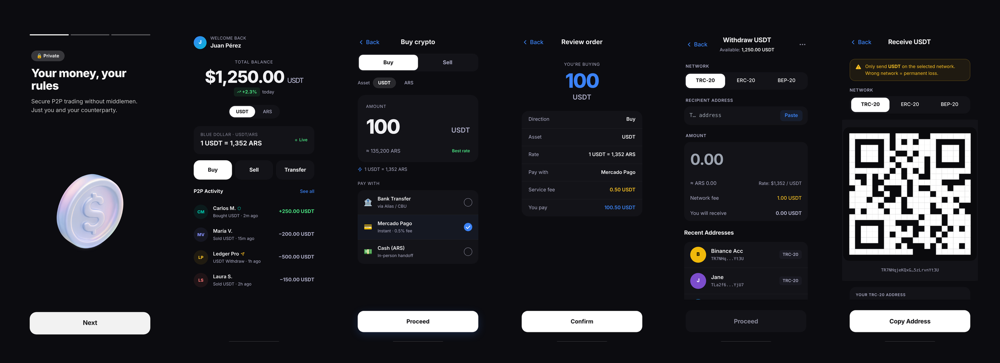
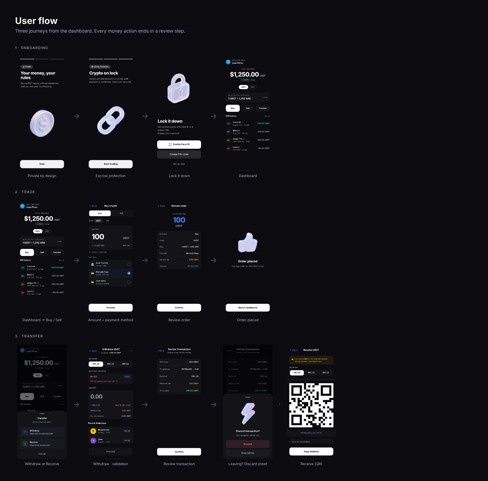
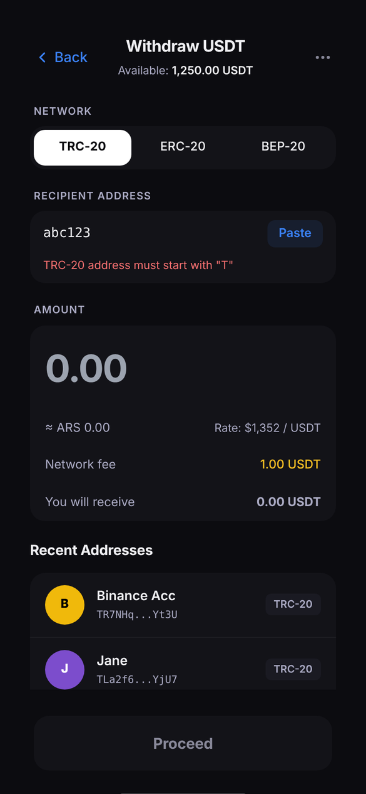
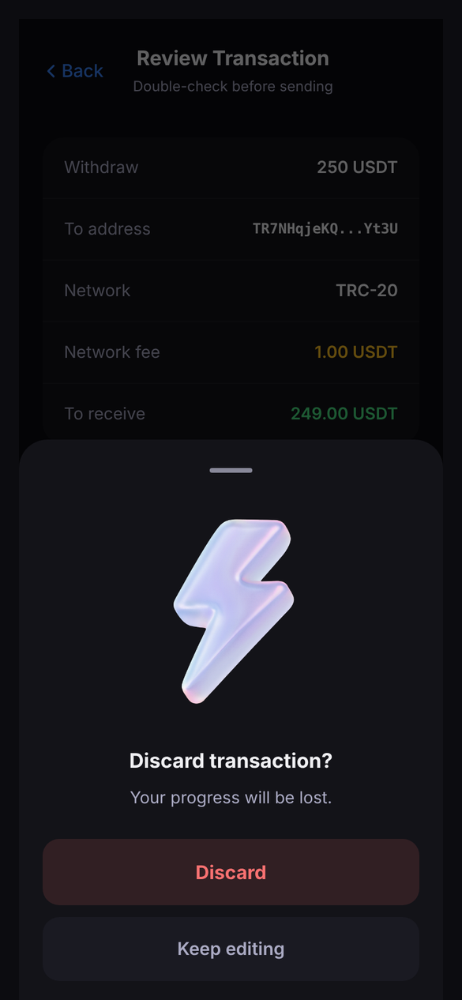
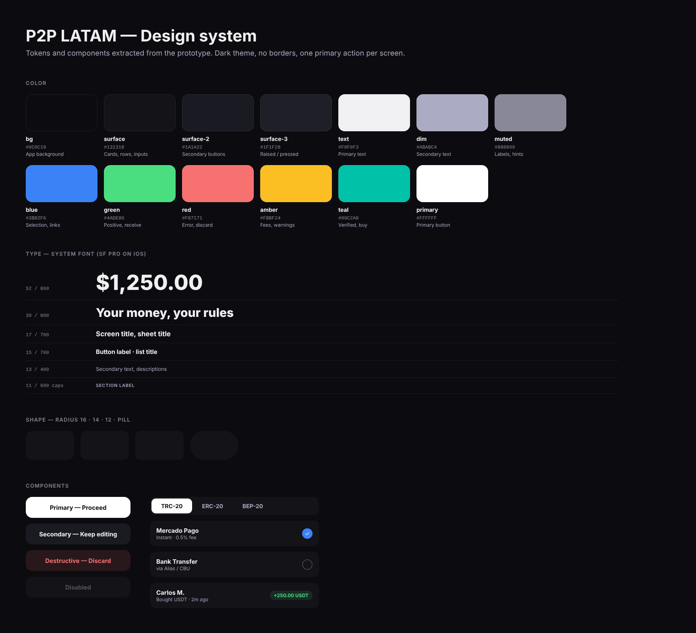
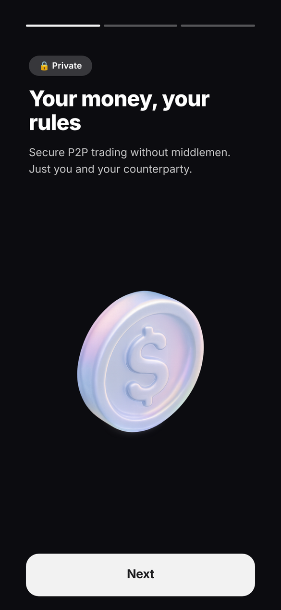

<h1 align="center">P2P LATAM</h1>
<p align="center"><b>A calm, trustworthy way to trade USDT for pesos — inside Telegram</b><br>
Product design case study · interactive prototype<br>
<i>A personal vibe-coding project: I design the product and direct AI to build it.</i><br>
by <b>Diana Romanova</b> · <a href="https://www.linkedin.com/in/ramanavad/">LinkedIn</a> · <a href="https://t.me/ramanavad">Telegram</a></p>

<p align="center">
  <a href="https://dramanava.github.io/p2p_latam/"><b>▶ Open the live prototype</b></a>
  <br><sub>Best on a phone, or in a narrow browser window</sub>
</p>

<p align="center"></p>

| | |
|---|---|
| **Role** | Product & UX/UI design — concept, flows, visual language, interaction details |
| **Platform** | Telegram Mini App (mobile, dark theme) |
| **Market** | Argentina — USDT ⇄ ARS at the "blue dollar" rate |
| **Status** | Interactive prototype with mocked data (no backend) |
| **Built with** | Vibe coding: I direct Claude Code through prompts, review each result in the browser and iterate. React + Vite, versioned on GitHub, published with GitHub Actions and Pages |

## Context

In Argentina many people exchange dollars for pesos at the informal "blue dollar" rate, and peer-to-peer trading of USDT is a common way to do it. Doing this inside Telegram means the interface has to feel safe in a place people already trust, with very little room for error: wrong network, wrong address, wrong amount.

## Design goals

1. **Feel safe.** Every money action ends in a review step; risky moments are explained before they happen.
2. **One obvious next step.** A single primary action per screen.
3. **Fit the container.** Behave like a native part of Telegram: fixed viewport, safe areas, bottom sheets.
4. **Stay quiet.** Minimal, borderless dark UI so numbers and decisions stand out.

## The flow

<p align="center"><a href="docs/user-flow.png"></a></p>

Three journeys start from the dashboard: **onboarding**, **trade** (buy / sell) and **transfer** (withdraw / receive). Click the image for full size.

## Key design decisions

<table>
  <tr>
    <td width="33%" valign="top"><br><b>Blue means “selected”</b><br>Primary actions are white. Blue is used only for active and chosen states, so it always carries one meaning.</td>
    <td width="33%" valign="top"><br><b>Catch mistakes early</b><br>Inline address validation names the exact rule, and Proceed stays disabled until the form is valid.</td>
    <td width="33%" valign="top"><br><b>Never lose input silently</b><br>Leaving a half-done transaction opens a Discard sheet with a clear destructive action.</td>
  </tr>
  <tr>
    <td valign="top"><br><b>Review before confirm</b><br>Buy, Sell and Withdraw all end on one summary with a single Confirm button.</td>
    <td valign="top"><br><b>Warn at the moment of risk</b><br>A wrong-network warning sits above the QR code, where the mistake would happen.</td>
    <td valign="top"><br><b>Security without friction</b><br>Face ID or PIN is offered with a quiet “Set up later”, so onboarding never feels like a gate.</td>
  </tr>
</table>

More detail, including what I tried and reverted, is in the **[design log](docs/design-log.md)**.

## Design system

<p align="center"><a href="docs/design-system.png"></a></p>

Colors, type scale, radii and components are documented above and available as code in [`design/tokens.json`](design/tokens.json).

## Onboarding

<table>
  <tr>
    <td align="center"><br><sub>Private by design</sub></td>
    <td align="center"><br><sub>Escrow protection</sub></td>
    <td align="center"><br><sub>Lock it down</sub></td>
    <td align="center"><br><sub>Dashboard</sub></td>
  </tr>
</table>

## How I use GitHub in this project

- **Version history of design decisions.** Every change to the UI is a commit, so the evolution of the product is traceable.
- **Design docs next to the code.** Flow, design system, tokens and a design log live in the repository.
- **Every push is published.** GitHub Actions builds the prototype and deploys it to GitHub Pages, so the live link always matches the latest design.

## How I work with AI

This is a personal vibe-coding project. The goal is to show how a product designer can take an idea to a working, shareable prototype by directing AI.

- **I own the product and design decisions.** Concept, flows, visual language and copy are mine. The AI writes the React code that implements them.
- **I work in small, specific iterations.** Each prompt changes one thing (spacing, a button state, a sheet behaviour). The design log shows how the UI evolved this way.
- **I review in the real thing.** I test every build in the browser, report bugs with screenshots (a broken Buy/Sell switch, clipped content, inconsistent screen heights) and ask for fixes.
- **I supply the visual assets.** I provide the 3D illustrations and specify where and how large they appear on each screen.
- **I ship it.** The project lives in a GitHub repository, is built and published automatically with GitHub Actions and Pages, and its next steps are tracked as issues.

## Technical notes

- **Stack:** React 18, Vite, Tailwind CSS (utility layer only), lucide-react.
- **Structure:** the whole UI is one component, `src/components/CryptoApp.jsx`, with a shared color palette object. That is deliberate for a prototype: it is easy to read and change.
- **Data:** all balances, rates, transactions and addresses are mocked in the code. No backend, no real blockchain calls.
- **Assets:** illustrations are optimised PNGs in `public/assets`, so the bundle is about 190 kB.
- **Deploy:** every push to `main` builds the app and publishes it to GitHub Pages (`.github/workflows/deploy.yml`).
- **For production, I would add:** a component split per screen, a typed API layer, tests for the withdraw validation, i18n (es-AR) and an accessibility pass. The first steps are in the [issues](https://github.com/Dramanava/p2p_latam/issues).

## What I would validate next

- Usability test of the withdraw flow with first-time crypto users.
- Spanish localisation and copy review with Argentine users.
- Accessibility pass: contrast and minimum text size in the dark theme.
- Real states: loading, network errors, order in progress, dispute.

## Run it locally

```bash
npm install
npm run dev
```

React 18 · Vite · Tailwind CSS · lucide-react. The prototype lives in [`src/components/CryptoApp.jsx`](src/components/CryptoApp.jsx).

## Credits

Product concept, UX flows and visual design: **Diana Romanova** ([LinkedIn](https://www.linkedin.com/in/ramanavad/) · [Telegram](https://t.me/ramanavad) · [GitHub](https://github.com/Dramanava)).
The prototype is a vibe-coding project: Diana directs, [Claude Code](https://claude.com/claude-code) writes the React implementation.
